<picture>
  <source media="(prefers-color-scheme: dark)" srcset="assets/hero-dark.svg">
  <source media="(prefers-color-scheme: light)" srcset="assets/hero-light.svg">
  
</picture>

<a href="https://github.com/shxiao111?tab=repositories">
<picture>
  <source media="(prefers-color-scheme: dark)" srcset="toc-dark.svg">
  <source media="(prefers-color-scheme: light)" srcset="toc-light.svg">
  
</picture>
</a>

<h3 align="center">
<picture>
  <source media="(prefers-color-scheme: dark)" srcset="assets/chapter-1-dark.svg">
  <source media="(prefers-color-scheme: light)" srcset="assets/chapter-1-light.svg">
  
</picture>
</h3>

<picture>
  <source media="(prefers-color-scheme: dark)" srcset="stats-dark.svg">
  <source media="(prefers-color-scheme: light)" srcset="stats-light.svg">
  
</picture>

<picture>
  <source media="(prefers-color-scheme: dark)" srcset="shelf-dark.svg">
  <source media="(prefers-color-scheme: light)" srcset="shelf-light.svg">
  
</picture>

<picture>
  <source media="(prefers-color-scheme: dark)" srcset="snake-dark.svg">
  <source media="(prefers-color-scheme: light)" srcset="snake-light.svg">
  
</picture>

<h3 align="center">
<picture>
  <source media="(prefers-color-scheme: dark)" srcset="assets/chapter-2-dark.svg">
  <source media="(prefers-color-scheme: light)" srcset="assets/chapter-2-light.svg">
  
</picture>
</h3>

<a href="https://github.com/shxiao111?tab=repositories">
<picture>
  <source media="(prefers-color-scheme: dark)" srcset="works-dark.svg">
  <source media="(prefers-color-scheme: light)" srcset="works-light.svg">
  
</picture>
</a>

<h3 align="center">
<picture>
  <source media="(prefers-color-scheme: dark)" srcset="assets/chapter-3-dark.svg">
  <source media="(prefers-color-scheme: light)" srcset="assets/chapter-3-light.svg">
  
</picture>
</h3>

<picture>
  <source media="(prefers-color-scheme: dark)" srcset="assets/footer-dark.svg">
  <source media="(prefers-color-scheme: light)" srcset="assets/footer-light.svg">
  
</picture>

<picture>
  <source media="(prefers-color-scheme: dark)" srcset="colophon-dark.svg">
  <source media="(prefers-color-scheme: light)" srcset="colophon-light.svg">
  
</picture>

art · 竹岡美穂「“文学少女”の追想画廊」 © 野村美月 / KADOKAWA

autumn preview of <code>main</code> at 95b51b6
